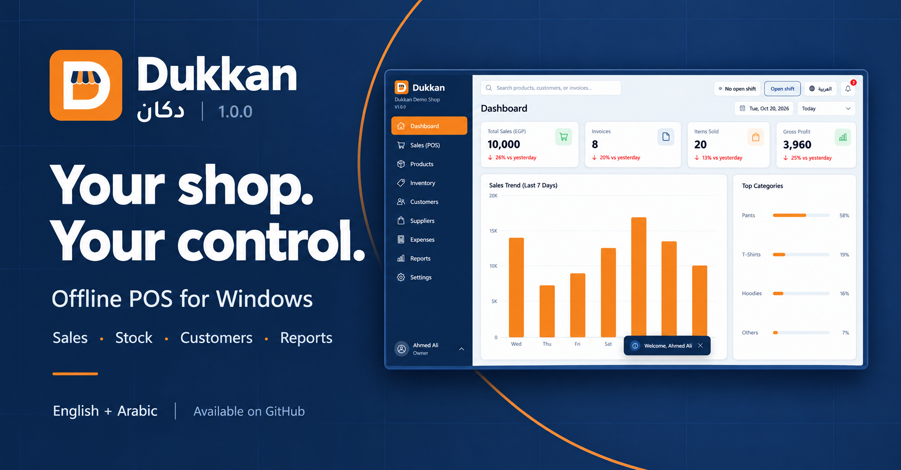

# Dukkan POS · دكان

[](https://github.com/MohamedAlaa001/dukkan-pos/releases/latest)

**An offline Windows point of sale for a single retail shop, in English and Arabic.**

Dukkan brings checkout, products, stock, customer accounts, suppliers and everyday reports into one desktop app. It started with a friend's clothing shop and supports general retail, including products with sizes and colors. Your shop's data stays on your PC, and everyday use does not require an internet connection.

[Download Dukkan 1.0.0 for Windows](https://github.com/MohamedAlaa001/dukkan-pos/releases/download/v1.0.0/Dukkan-Setup-1.0.0.exe) · [User guide](docs/USER_GUIDE.md) · [Report a problem](https://github.com/MohamedAlaa001/dukkan-pos/issues)

## Install and get started

1. Open the [Dukkan 1.0.0 release](https://github.com/MohamedAlaa001/dukkan-pos/releases/tag/v1.0.0) and download `Dukkan-Setup-1.0.0.exe` from **Assets**.
2. Close Dukkan if it is already running, then run the installer. It installs for your Windows account and creates Desktop and Start menu shortcuts. Administrator rights and a separate .NET installation are not required.
3. On first launch, enter your shop details, create your owner account and choose how you enter tax in prices.
4. Save your account recovery codes and backup recovery secret somewhere safe, away from the shop PC.
5. Add your products, set up your printers and backup folder, then open a shift to start selling.

The installer is for **64-bit Windows** and includes the .NET runtime. Updates replace the application files while keeping business data separately. Dukkan appears in Windows **Installed apps**, where you can uninstall it.

The repository and release downloads are public. You do not need a GitHub account to download the installer.

## What you can do

| Area | Features |
|---|---|
| Checkout | Barcode scanning, size/color variants, held carts, discounts, sales and returns |
| Payments | Cash, recorded Visa/Instapay/wallet payments, split payments and customer credit |
| Customers | Accounts, installments, collections, statements and loyalty points |
| Products and stock | Product images, CSV import, labels, stock counts, locations, transfers, lots/expiry and reorder suggestions |
| Suppliers | Purchase orders, receiving, invoices, payments, returns and supplier credit |
| Offers | Percentage/fixed discounts, buy/get offers, bundle prices and coupons |
| Reports | Sales, profit, payment methods, inventory valuation, dead stock and daily summaries; localized CSV exports |
| Documents | 80 mm receipts, A4 invoices, PDF output and product labels |
| Shop controls | Owner/cashier permissions, shifts, expenses, audit history and encrypted backups |
| Languages | English and Arabic, including right-to-left layouts |

Electronic payment methods record payments confirmed outside Dukkan. The app does not charge cards, initiate transfers or connect to a bank terminal. It does not provide ETA fiscal e-receipt submission, WhatsApp/SMS messaging or multi-device synchronization.

## Keep your shop data safe

Business data normally lives in `%LocalAppData%\Dukkan`, separately from installed program files. Configure encrypted backups to an external drive or another safe location. Restoring an encrypted backup requires your backup recovery secret.

Updates take a verified database snapshot before migrating it. **Older application versions cannot open a newer database schema.** Read the [update and recovery guide](docs/USER_GUIDE.md) before changing versions.

Before putting Dukkan into daily shop use, test your actual scanner and receipt/label printers, practise restoring an encrypted backup on a spare PC, and complete the pilot checklist in the user guide. Installers are currently unsigned.

## Current release

**Version 1.0.0 · Database schema 16**

Download the [Windows installer](https://github.com/MohamedAlaa001/dukkan-pos/releases/download/v1.0.0/Dukkan-Setup-1.0.0.exe), read the [1.0.0 release notes](https://github.com/MohamedAlaa001/dukkan-pos/releases/tag/v1.0.0), or verify your download against the [SHA-256 checksums](https://github.com/MohamedAlaa001/dukkan-pos/releases/download/v1.0.0/SHA256SUMS.txt). See the user guide for supported workflows and deployment checks.

## Why Dukkan exists

A friend needed a POS for a clothing shop. That became a practical challenge: how quickly could a useful desktop product be delivered while keeping a clear specification, reliable workflows and a straightforward installation?

The work combined product research and a written PRD with AI-assisted design, implementation and debugging. Interactive end-to-end checks exercised the Windows application and caught issues beyond the automated tests. Dukkan is now publicly available for people to download, try and give feedback on.

## For developers

Dukkan uses **C#/.NET 8, WPF and SQLite**. Build on Windows with the .NET 8 SDK:

```powershell
dotnet restore Dukkan.sln
dotnet build Dukkan.sln
dotnet test Dukkan.sln --no-restore --nologo -v minimal
```

The desktop project is `src/Dukkan.UI`; the application is `Dukkan.exe`. Supporting libraries separate domain rules, application contracts, SQLite persistence and printing.

Build the offline installer from the repository root with `dotnet` on PATH:

```powershell
.\installer\Build-Installer.ps1
.\installer\Build-SetupExe.ps1
```

Outputs are `dist/Dukkan-Setup/` and `dist/Dukkan-Setup.exe`. The user guide is included automatically. Generated installers are distributed through Releases rather than committed to source control.

Money is stored as integer piastres and quantities as milli-units. Corrections preserve posted history through ledger entries, postings use idempotency keys, and permissions are enforced in services. Use isolated test data for development. See the [development guide](docs/DEVELOPMENT.md) for project structure, UI resources and Debug-only capture options.

- [User guide](docs/USER_GUIDE.md)
- [Development guide](docs/DEVELOPMENT.md)

## Feedback and availability

Please report problems with the version shown on the home screen, the steps to reproduce, and your Windows/printer details where relevant. Remove shop records, customer details and credentials from anything you attach.

Source code and installers are publicly available. An open-source license has not yet been selected.
